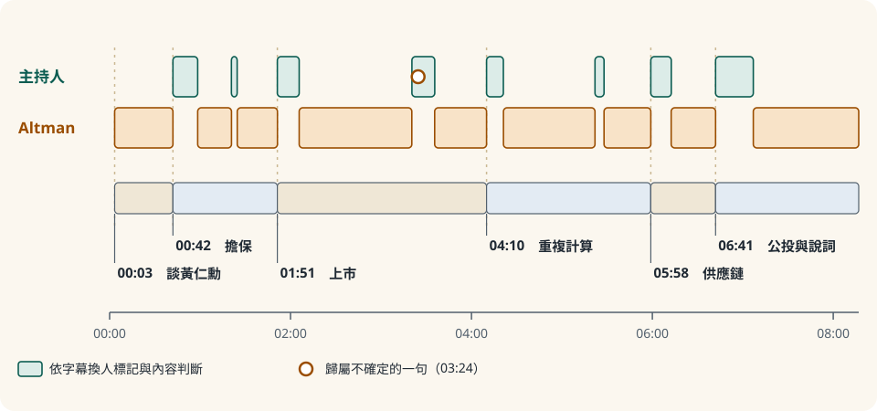
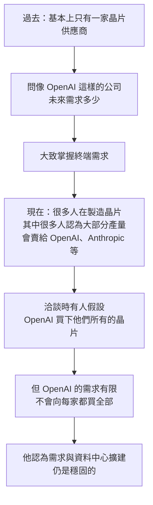

# 「英雄也有缺點」：Altman 被問到黃仁勳回任，說了什麼、沒說什麼

> 本導讀的分析與撰稿由 AI 模型完成，不是人類分析，也沒有經過人工逐句校稿；內容依 YouTube 機器字幕整理，可能有誤聽。

*圖：原創 AI 插畫，以底座出現裂縫的英雄雕像比喻「英雄也有缺點」，兩張空椅子代表這場對談。*

影片標題問的是黃仁勳要不要回輝達當執行長，Sam Altman 開口第一句卻是：「我想我了解得還不夠多，無法回答那個問題」（[00:03](https://www.youtube.com/watch?v=RizP4UPzxDU&t=3s)）〔Altman〕。**接下來約八分鐘的片段，談黃仁勳的部分加起來不到兩分鐘**。主持人很快把話題帶到輝達的擔保、Anthropic 本週要上市、晶片需求的「重複計算」、輝達對中國出貨（Altman 接著談的是供應鏈），最後是資料中心公投與民眾對 AI 的反感。

這支影片由 DRM News 頻道在 2026-11-16 上傳，畫面標示為 Semafor 的「Silicon Valley & The World」活動，受訪者是 OpenAI 執行長 Sam Altman。依 Semafor 的報導，這場訪談約 30 分鐘，主持人是該媒體的 Reed Albergotti〔官方〕；本片段只是其中約八分鐘。訪談的時間背景是：輝達在 2026-11-12 公告黃仁勳辭去總裁、執行長與董事職務，由財務長 Colette Kress 擔任臨時執行長，董事會啟動永久人選的搜尋；公告沒有寫辭職原因〔官方〕。

標籤說明：〔Altman〕為 Altman 在片段中的說法；〔主持人〕為主持人的提問或敘述，其中的事實與數字不是 Altman 的主張；〔官方〕為官方公告、SEC 文件或媒體本人的文章；〔媒體〕為新聞媒體或律所文章，屬二手資料；〔本文類推〕為本文從內容延伸的推測，不是講者說法。標「單一二手來源」或「未查證」的，只有轉述或尚未核對。文中外部事實的查證資料截至 2026-11-17。

## 三十秒版

- 被問到黃仁勳該不該回任，Altman 說自己了解得不夠、無法回答；同時稱他是「英雄」，並說「英雄也有缺點」〔Altman〕。
- 他說輝達與黃仁勳顯然有極深的連結；被追問會不會有連鎖反應時，他說「我認為這個產業不會有問題」，理由是需求強勁〔Altman〕。
- 談上市：OpenAI「在某個時間點是會上市的」，上市有真正的缺點；被問到 Anthropic 先上市後投資人需求還夠不夠，他說那不是隱憂〔Altman〕。
- 「重複計算」：許多晶片廠商以為會把大部分產量賣給 OpenAI、Anthropic 等，也有人假設 OpenAI 會買下他們所有的晶片，但他說 OpenAI 的需求有限，需求與資料中心擴建則是穩固的〔Altman〕。
- 談民眾對 AI 的反感：他說，如果推銷說詞是拿治癒癌症和便宜的東西去換人類自主權，那是糟糕透頂的推銷，他不想要那樣的世界；這是條件句，他沒有說產業實際上就這樣講〔Altman〕。
- 沒說的部分：他沒有點明「那是怎樣的感覺」指什麼，字幕上也看不出他回應了輝達對中國出貨的提問。

## 八分鐘怎麼分段

下圖把片段約八分鐘裡主持人與 Altman 的輪替，和後面六節各自的位置放在同一條時間軸上。圓圈標的是歸屬不確定的一句，原因見〈讀這段訪談要記得的限制〉；其餘區段的歸屬依字幕換人標記與內容判斷，存疑的幾處另用影片核對過。

*圖：片段約八分鐘裡主持人與 Altman 的輪替與六個章節的位置。歸屬依字幕換人標記與內容判斷，圓圈標的一句歸屬不確定。資料來自字幕與本文整理。*

## 談黃仁勳：先說了解得不夠

Altman 先用開場那句不表態（[00:03](https://www.youtube.com/watch?v=RizP4UPzxDU&t=3s)），隨即給了肯定：**「黃仁勳一直以來都是我心目中的英雄。英雄也有缺點。我很感謝他所建立的這家公司」**（[00:06](https://www.youtube.com/watch?v=RizP4UPzxDU&t=6s)）。然後談到自己：「我個人確實對這樣的情況有著強烈的同理心」（[00:13](https://www.youtube.com/watch?v=RizP4UPzxDU&t=13s)），接著說「我還記得那是怎樣的感覺，雖然感覺好像已經是很久以前的事了」（[00:21](https://www.youtube.com/watch?v=RizP4UPzxDU&t=21s)）。

**他沒有說「那是怎樣的感覺」指的是什麼**。Semafor 的報導提到他約三年前曾被解職、不久後復職〔官方〕；兩者可能有關，但這是本文的推測〔本文類推〕。

回到 Altman 的原話，他也談了兩家公司的關係：黃仁勳建立的公司「很早就押注在我們身上」，「我們也很早就押注在他身上」，並說很難想像沒有黃仁勳的 AI 革命會是什麼樣子（[00:26](https://www.youtube.com/watch?v=RizP4UPzxDU&t=26s)）。

## 擔保，與少了黃仁勳的輝達

主持人接著說，輝達也為 OpenAI 的俄亥俄資料中心擔保了「1,050 億美元」，稱輝達像「銀行」一樣支撐整個產業，問這項擔保是否還像幾週前那樣有價值（[00:42](https://www.youtube.com/watch?v=RizP4UPzxDU&t=42s)）〔主持人〕。**這個數字是主持人說的，Altman 沒有重述。**

Altman 的回答是：輝達是「一家龐然大物般的公司」，「我想大家仍然非常信任他們的擔保」（[00:58](https://www.youtube.com/watch?v=RizP4UPzxDU&t=58s)）。但他也說，黃仁勳和輝達「顯然有著極深的連結」，他所展現的雄心與規模，對這個產業一直相當重要（[01:06](https://www.youtube.com/watch?v=RizP4UPzxDU&t=66s)）。主持人追問是否會有連鎖反應（[01:20](https://www.youtube.com/watch?v=RizP4UPzxDU&t=80s)），他說目前需求非常龐大，AI 是實實在在的，**「我認為這個產業不會有問題」**（[01:32](https://www.youtube.com/watch?v=RizP4UPzxDU&t=92s)）。談到黃仁勳本人，他說對方「扮演了極其特別且寶貴的角色，懷抱遠大的雄心，真正推動事情向前」（[01:41](https://www.youtube.com/watch?v=RizP4UPzxDU&t=101s)）。

## Anthropic 要先上市，OpenAI 想不想？

主持人接著把話題轉到上市：Anthropic 本週要上市，而投資人正充滿懷疑，問 Altman 自己想不想上市，能避開的話會不會避開（[01:51](https://www.youtube.com/watch?v=RizP4UPzxDU&t=111s)）〔主持人〕。

Altman 先說，懷疑有很多來自記者，投資人看起來對 AI 相當看好（[02:05](https://www.youtube.com/watch?v=RizP4UPzxDU&t=125s)）。他認為事情總有起落，價格會起伏，總有過度建設與建設不足的時期，但整體趨勢是「龐大的價值正在被創造出來」，同時「也有龐大的價值正在被顛覆」（[02:12](https://www.youtube.com/watch?v=RizP4UPzxDU&t=132s)）。

關於上市本身，他說：**「我們在某個時間點是會上市的」（[02:44](https://www.youtube.com/watch?v=RizP4UPzxDU&t=164s)），但「上市確實有真正的缺點」**（[02:48](https://www.youtube.com/watch?v=RizP4UPzxDU&t=168s)）。理由是產業正處於高度動盪的時期，要做出牽涉安全與社會互動、後果重大的決策；作為未上市公司，有些事處理起來更容易（[02:53](https://www.youtube.com/watch?v=RizP4UPzxDU&t=173s)）。另一方面，他說想投資的不只是剛好能進入未上市市場的投資人，「全世界都希望能參與其中」，從方向上看是好事（[03:07](https://www.youtube.com/watch?v=RizP4UPzxDU&t=187s)）。

主持人再問：Anthropic 會先上市嗎？OpenAI 上市後，還剩下足夠的投資人需求嗎，還是會變成「他們 Uber 旁邊的 Lyft」，這是不是隱憂（[03:20](https://www.youtube.com/watch?v=RizP4UPzxDU&t=200s)）〔主持人〕。字幕這裡作 lift，疑為 Lyft 的誤聽。Altman 答：**「那不是隱憂」**（[03:35](https://www.youtube.com/watch?v=RizP4UPzxDU&t=215s)）。他說理解記者每天都得寫點東西，總要有「這場爭鬥和那場爭鬥、誰是贏家誰是輸家」（[03:37](https://www.youtube.com/watch?v=RizP4UPzxDU&t=217s)）。但就宏觀趨勢與正在被創造的價值而言，「我一點也不擔心規模會不夠龐大」（[03:46](https://www.youtube.com/watch?v=RizP4UPzxDU&t=226s)）；他還說，看待過去一年的一種方式是「投資人的需求實在太多了，而供給卻不足」（[03:55](https://www.youtube.com/watch?v=RizP4UPzxDU&t=235s)）。

## 「重複計算」是什麼意思

主持人接著換了題目，轉述一則報導：Altman 在閉門場合向三星高層表示，這個產業存在某些「重複計算」，請他解釋（[04:10](https://www.youtube.com/watch?v=RizP4UPzxDU&t=250s)）〔主持人〕。

Altman 的解釋從過去說起。過去很長一段時間，產業基本上只有一家晶片供應商，大家計算晶圓數量時，可以詢問像他這樣的公司未來需求會是多少，藉此大致了解終端使用者的需求（[04:21](https://www.youtube.com/watch?v=RizP4UPzxDU&t=261s)）。現在有很多人在製造晶片，其中很多人「都認為他們會把大部分產量賣給我們、Anthropic 以及其他公司」（[04:44](https://www.youtube.com/watch?v=RizP4UPzxDU&t=284s)）。但「我們的需求、資料中心以及其他一切都是有限的」，**許多做晶片的人在跟供應鏈洽談時「假設我們會買下他們所有的晶片」**（[04:53](https://www.youtube.com/watch?v=RizP4UPzxDU&t=293s)）。他認為需求與資料中心的擴建都是「穩固的」，只是「我們不可能、也不需要向每一家晶片廠商購買我們所有的供應」（[05:08](https://www.youtube.com/watch?v=RizP4UPzxDU&t=308s)）。

*圖：依 Altman 的解釋整理。「重複計算」是主持人轉述報導的用語；圖中沒有新增數字。*

主持人問這對產業意味著什麼，行情是不是結束了、價格是不是定得太高（[05:21](https://www.youtube.com/watch?v=RizP4UPzxDU&t=321s)）〔主持人〕。Altman 說一定會有起伏，但對龐大運算能力的長期需求，以及它所釋放的價值，他認為會持續下去（[05:27](https://www.youtube.com/watch?v=RizP4UPzxDU&t=327s)）。

> 重點：他把長短期分開講：「長期趨勢是明確的」，而季與季、年與年之間供需是否能精準吻合，「就比較難說了」（[05:45](https://www.youtube.com/watch?v=RizP4UPzxDU&t=345s)）。

## 供應鏈卡在哪裡

主持人回頭接 Altman 剛才那句晶片廠商指望 OpenAI 買下所有晶片的話，說很有意思，自己原本還以為 OpenAI 確實想全部買下；接著問：看整個輝達事件的一個角度，是不是輝達現在不再出貨給中國（[05:58](https://www.youtube.com/watch?v=RizP4UPzxDU&t=358s)）〔主持人〕。字幕在這裡斷在「那似乎是……」，**從字幕看不出 Altman 有沒有直接回應中國出貨這個問題**。他接著談的是供應鏈：「供應鏈非常複雜」，不同時期受制於不同的事物，有時是記憶體，有時是機櫃組裝，有時是資料中心容量，有時是「某個隨機的零組件」，字幕聽起來像是「PCB laminate」缺貨（[06:13](https://www.youtube.com/watch?v=RizP4UPzxDU&t=373s)）〔Altman〕。

## 公投、民意，以及一個糟糕的推銷說詞

主持人接著換到另一則新聞：最近的 blue wave（字幕原文，未解釋），說資料中心的公投法案「我想除了其中一項之外」都通過了，人們討厭資料中心，跨黨派的選民情緒有許多是反對 AI 的，然後問：這個產業怎麼會把講述這項技術的故事搞得這麼糟糕（[06:41](https://www.youtube.com/watch?v=RizP4UPzxDU&t=401s)）〔主持人〕。

Altman 的回答從一個條件句開始：他認為，如果推銷說詞是「我們要為你提供治癒癌症的方法和便宜的東西」，代價是你未來將失去所有的自主權、控制權和發言權，「你會活得像隻拉布拉多」，機器也許會試著讓你開心，我們則急著把未來的控制權交給 AI（[07:06](https://www.youtube.com/watch?v=RizP4UPzxDU&t=426s)）。他的評價是：**「我認為這是一個糟糕透頂的推銷說詞。我不想要那樣的世界」**，「我認為大多數人也不想要那樣的世界」（[07:37](https://www.youtube.com/watch?v=RizP4UPzxDU&t=457s)）。

> 重點：他說的是如果說詞是這樣；他沒有說產業實際上就是這樣在說。

他說經濟層面也有其他重大問題，但「我認為從根本上說，如果你去和那些真正不喜歡 AI 的人談談，越過最初那些表面話題——」（[07:44](https://www.youtube.com/watch?v=RizP4UPzxDU&t=464s)）。話在這裡中斷，下一句他說：「我想資料中心很容易成為箭靶，因為它們像是這個更宏大事物的一個具體實體展現」（[07:54](https://www.youtube.com/watch?v=RizP4UPzxDU&t=474s)）。工作方面的問題「是人們非常深切感受到的真實近期擔憂」（[08:00](https://www.youtube.com/watch?v=RizP4UPzxDU&t=480s)）；長期的問題則是人類在社會中將扮演什麼角色，以及權力平衡將會……（[08:05](https://www.youtube.com/watch?v=RizP4UPzxDU&t=485s)）。片段停在這句沒說完的話。

## 查證對照：主持人提到的事與背景

導讀以 Altman 說了什麼為主，下表把主持人提出的事，以及讀者最可能想核對的背景，集中對照。

| 說法（誰說） | 查證結果 | 標籤 |
|---|---|---|
| 輝達為 OpenAI 俄亥俄資料中心擔保 1,050 億美元（主持人） | 輝達 2026-08-17 向 SEC 提交的 8-K 載明其付款義務累計上限為 1,050 億美元（針對初始承諾）。性質是殘值擔保：只在 OpenAI 租約違約等觸發事件發生時，補足保證最低價值與再租或出售所得之間的差額；OpenAI 同意補償輝達實際支付的金額。它不涵蓋整個專案成本，也不是替 OpenAI 的所有債務擔保。 | 〔官方〕 |
| Anthropic 本週上市（主持人） | Anthropic 官方 IPO 網站與 SEC 文件寫預計 2026-11-18 定價、11-19 在 Nasdaq 掛牌（代碼 ANT），皆須經監管許可。截至 2026-11-17 尚未發生。 | 〔官方〕 |
| 向三星高層說「重複計算」（主持人轉述） | 只找到轉述此事的二手報導，稱出自韓國 Financial News，會議約在 2026-10-31、約 50 位三星高層出席；未找到原報導，也沒有 OpenAI 或三星的說明。本片段 Altman 自己的解釋見〈「重複計算」是什麼意思〉一節。 | 單一二手來源 |
| 資料中心公投法案除了一項之外都通過（主持人） | 與 Route Fifty 對 2026-11-03 地方公投的初步統計大致吻合：約 40 項，唯一例外據報為北達科他州 Harwood；Venable 則計為 41 項。這些是地方公投與章程修正，部分屬諮詢性質，不是州級「法案」，且結果為初步。 | 〔媒體〕 |
| 黃仁勳辭職與回任（背景） | 輝達 2026-11-12 公告：黃仁勳辭去總裁、執行長與董事，即刻生效；公告未寫原因，也未提任何調查。Semafor 寫他「據報」考慮東山再起，且有部分科技界人士推動他回任。 | 〔官方〕 |
| 輝達「不再出貨給中國」（主持人） | 本文未查證。 | 未查證 |

## 讀這段訪談要記得的限制

- **只是片段。** 完整訪談約 30 分鐘，本片段約八分鐘，前後內容看不到；片段最後一句也沒說完。
- **字幕是機器產生，未逐句對照原音。** 可能有誤聽（如 Lyft 疑被聽成 lift，兩者同音，音訊無法區分，只能依上下文推定）；「PCB laminate」「blue wave」等幾個詞另請 agy 聽音訊核對，結果與字幕一致，但那只是線索，不是人工聽寫；"um"、重複詞在譯文中多半省略。
- **說話者是推定的。** 字幕沒有說話者標記。本文依換人標記與內容判斷誰在問、誰在答：Altman 的畫面名牌（「Sam Altman／CEO, OpenAI」）短暫出現在影片開頭，主持人姓名依 Semafor 文章為 Reed Albergotti，畫面上沒有他的名牌。05:58 到 06:12 之間輝達與中國出貨的提問，歸屬主持人，以及 07:06 之後 Altman 的回答（含「拉布拉多」與「糟糕透頂的推銷說詞」），原本只靠內容判斷、沒有換人標記，後來另用 agy 聽音訊判斷換人時間，並與影格交叉，結果都支持原判斷（只有一支片段起點的前 3 秒出現矛盾，判斷是片段起點的誤判）；但 agy 只做得到換人判斷，沒有逐字核對，對照組也只有 3 支短片、4 個換人點，樣本很小，結果只當線索。03:24 前後那句「那很明確」仍無法確認歸屬，本文未引用。
- **主持人的話不是 Altman 的主張。** 1,050 億美元、三星報導、公投、中國出貨都是主持人提出的前提。
- **Altman 有利害關係。** 他是 OpenAI 執行長，談的正是上市、競爭對手 Anthropic 與晶片供應，這些說法反映他的立場。
- **影片是轉載頻道上傳的剪輯。** 本文沒有找到 Semafor 的完整影片或逐字稿。

## 製作說明：這篇導讀由 AI 模型完成

研究、翻譯、撰稿與查證皆由 AI 模型完成，不是人類分析，也未經人工逐句校稿。主控與撰稿為 Claude Sonnet 5.5；英文逐句翻譯為 agy（gemini-3.8-flash-high）初譯，再由 Claude Sonnet 5.5 修詞；全文譯文見[全文譯本](translation-zh.html)，雙語字幕見[字幕播放器](player.html)。封面為 AI 生圖（Codex imagegen，圖內不含文字與真人臉）；〈八分鐘怎麼分段〉的分段圖是腳本依字幕時間與講者歸屬表繪製的 SVG，歸屬不確定的一句以圓圈標示。完成後由三位審稿人分段把關：事實（Claude Sonnet）、編輯與可讀性（Claude Opus）、修稿後終審（Claude Sonnet）；最後再由 Claude Opus 依總編輯準則潤稿並標示重點，並另請總編輯審一次上下文、語意與話題銜接。英文字幕是 YouTube 機器自動字幕，未逐句對照原音；存疑的講者歸屬與幾個詞，另用 agy（以 gemini-3.8-flash-high 為主，必要時 gemini-4-hydrogen-high）聽少數片段核對換人時間，再以影格交叉，結果只當線索。查證採計原則：重要說法優先採官方或第一手來源，只有二手者標〔媒體〕或降級標示。

## 來源清單

### 影片
- [“Heroes Have Flaws” OpenAI's Sam Altman on Jensen Huang's Possible Return as Nvidia CEO | AI1N](https://www.youtube.com/watch?v=RizP4UPzxDU)（DRM News 頻道，2026-11-16）
- 本導讀的 [全文譯本](translation-zh.html)

### 官方一手
- [Semafor：‘Heroes have flaws’: Sam Altman says he has personal empathy for Jensen Huang](https://www.semafor.com/article/11/16/2026/altman-says-he-has-personal-empathy-for-jensen-huang)（2026-11-16 更新）
- [NVIDIA Announces CEO Transition](https://nvidianews.nvidia.com/news/nvidia-announces-ceo-transition)（2026-11-12）
- [NVIDIA 8-K：OpenAI 俄亥俄資料中心殘值擔保](https://www.sec.gov/Archives/edgar/data/1045810/000104581026000069/nvda-20260817.htm)（2026-08-17）
- [Anthropic 官方 IPO 網站](https://ipo.anthropic.com/)與 [SEC 免費寫作說明書](https://www.sec.gov/Archives/edgar/data/2130357/000162828026072949/anthropicpbc-fwpipowebsi.htm)（2026-11-10）

### 媒體與二手
- [Route Fifty：Voters reject data centers in local ballot initiatives](https://www.route-fifty.com/artificial-intelligence/2026/11/voters-reject-data-centers-local-ballot-initiatives/417033/)（2026-11-04）
- [Venable：Voters approve data center restrictions](https://www.venable.com/insights/publications/2026/11/voters-approve-data-center-restrictions)（2026-11-04）
- [Crypto Briefing：Sam Altman warns AI demand may be double counted](https://cryptobriefing.com/sam-altman-warns-ai-demand-double-counted/)（2026-11-11，轉述韓國 Financial News，未見原報導）
